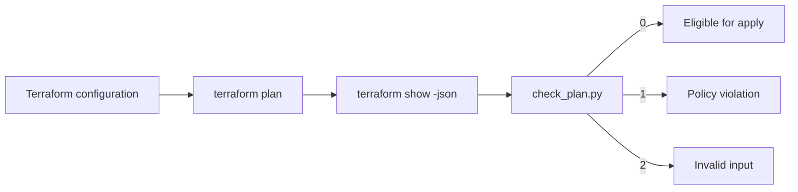

# Design document: Terraform plan policy checker

## Problem

Terraform can produce a syntactically valid plan that would expose a Cloud Storage bucket publicly or omit ownership labels. That risk should be caught before an apply step.

## Goal

Read Terraform JSON plan output and fail the pipeline when a planned GCP storage change violates a small policy set.

## Design



- Cloud Storage buckets must set `public_access_prevention = "enforced"`.
- Every bucket must have nonempty `environment` and `owner` labels.
- Bucket IAM member, binding, and policy resources cannot include `allUsers` or `allAuthenticatedUsers`.
- Unknown required values fail closed because the checker cannot prove they are safe.
- Deleted-only resources are ignored because they will not exist after the change.

## Verification

```bash
python check_plan.py examples/pass-plan.json
python check_plan.py examples/fail-plan.json
python -m unittest discover -s tests -v
```

The safe fixture returns `0`. The unsafe fixture returns `1` and prints three violations. CI expects the unsafe fixture to fail, which proves the guardrail is active.

## Risks and limits

The repository demonstrates the policy with offline plan fixtures. A production workflow would generate the JSON from a real plan and place the checker immediately before an approved apply step. This project does not create a bucket.

