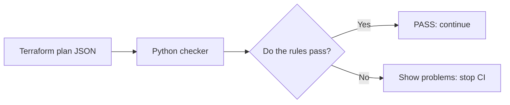
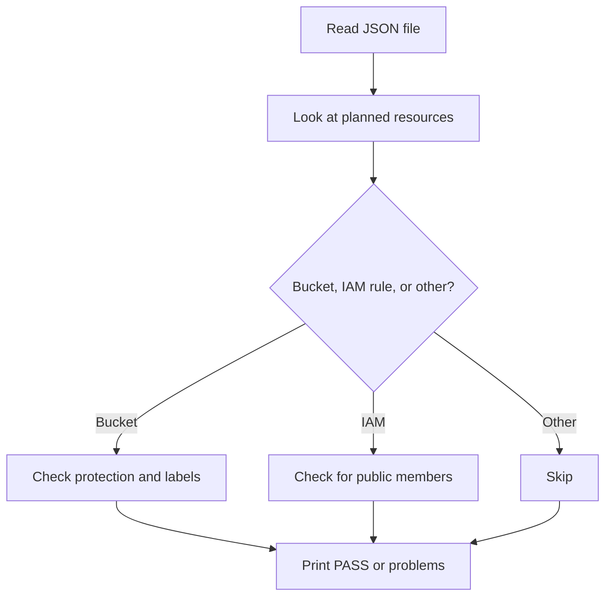

# Presentation Script: GCP Terraform Plan Checker

**Estimated time:** 2–3 minutes

## The script

### 1. Introduce the problem

“Hi, today I’m presenting a small tool that checks a Terraform plan for risky Google Cloud Storage settings.

Terraform can show us what it plans to create or change before those changes happen. But a plan can still include a public bucket, missing ownership labels, or access for everyone. This checker looks for those problems before deployment.”

### 2. Explain the solution

“The checker reads Terraform’s plan as JSON. It checks three simple rules:

1. Every planned storage bucket must have public access prevention turned on.
2. Every bucket must have an `environment` label and an `owner` label.
3. Bucket access rules must not include `allUsers` or `allAuthenticatedUsers`, which represent public access.

If the plan is safe, it prints `PASS`. If it finds problems, it prints each one and exits with a failure code. That means a CI workflow can stop the plan from moving forward until someone fixes it.”

### 3. Show the flow



“The checker only reads the plan file. It does not connect to Google Cloud, create buckets, or change infrastructure.”

### 4. Demonstrate a passing plan

“First, I’ll check the safe example.”

```bash
python check_plan.py examples/pass-plan.json
```

Expected output:

```text
PASS: GCP storage policy checks passed
```

“This plan passes because the bucket has public access prevention enabled, has both required labels, and does not grant public access.”

### 5. Demonstrate a failing plan

“Now I’ll check an example that has problems.”

```bash
python check_plan.py examples/fail-plan.json
```

Expected output:

```text
FAIL: google_storage_bucket.example: public access prevention must be enforced
FAIL: google_storage_bucket.example: missing labels: owner
FAIL: google_storage_bucket_iam_member.public: public IAM member allUsers is not allowed
```

“The checker reports all three problems in one run, so the developer knows what to fix. It exits with code 1, which tells CI that the check failed.”

### 6. Explain the code simply

“The main file is `check_plan.py`. It opens the JSON, looks through the planned resources, and checks the rules that apply to each resource. It ignores resources that are only being deleted. If a required value is unknown before deployment, the checker fails closed: it reports that the value cannot be checked instead of assuming it is safe.”



### 7. Close

“In summary, this is a small pre-deployment safety check. It helps catch public access and missing metadata early, and it can run automatically in CI. The examples let us demonstrate both a passing and failing plan without cloud credentials or real infrastructure.”

## Optional: run the tests

If there is time, show that the project also includes automated tests:

```bash
python -m unittest discover -s tests -v
```

## Quick reference

| Result | Meaning |
| --- | --- |
| Exit code `0` | The plan passed the checks. |
| Exit code `1` | The plan has one or more policy violations. |
| Exit code `2` | The command or input file is invalid. |

The checker is a starter policy example. It checks the rules listed above; it is not a complete audit of every GCP security setting.
