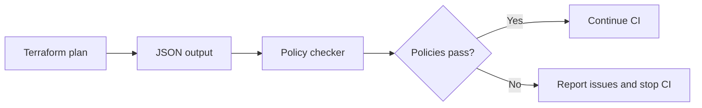
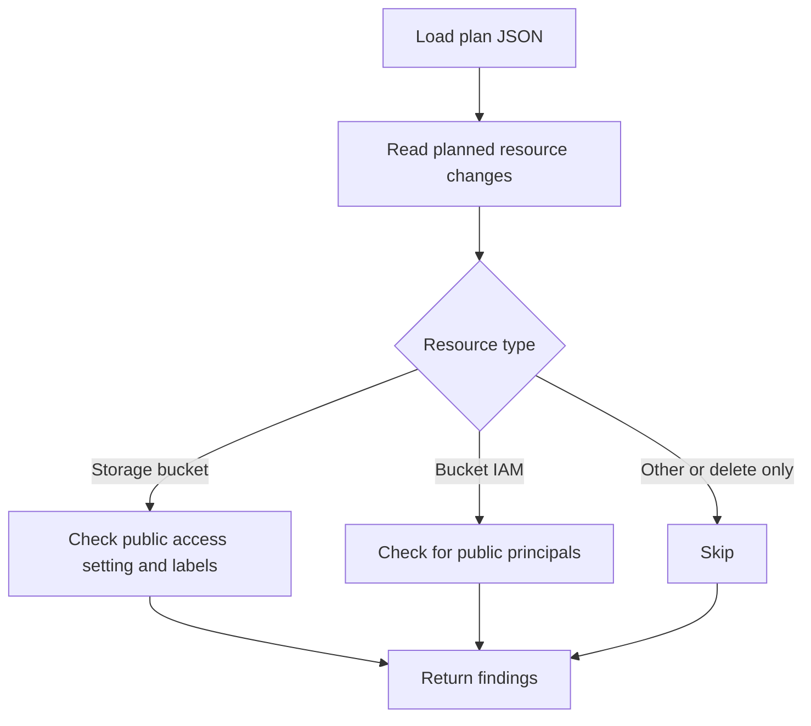

# GCP Terraform Plan Policy Checker

## Pre-deployment policy demonstration

### 1. The problem

Terraform plans show proposed infrastructure changes before deployment. A plan could still configure a publicly accessible Cloud Storage bucket, omit useful ownership labels, or grant access to everyone.

**Goal:** catch these issues before infrastructure is deployed.

### 2. The solution

This Python checker reads Terraform plan JSON and checks a small set of Cloud Storage policies. It reports violations before deployment and can be used as a CI check.



### 3. Policies checked

| Resource | Required policy |
| --- | --- |
| Cloud Storage bucket | Public access prevention is `enforced`. |
| Cloud Storage bucket | Nonempty `environment` and `owner` labels are present. |
| Bucket IAM member, binding, or policy | No public principals: `allUsers` or `allAuthenticatedUsers`. |

Unknown required values fail the check because their safety cannot be confirmed before deployment. Resources that are only being deleted are skipped.

### 4. Demonstration: passing plan

```bash
python check_plan.py examples/pass-plan.json
```

```text
PASS: GCP storage policy checks passed
```

The example bucket has public access prevention enabled, both required labels, and no public IAM principal.

### 5. Demonstration: failing plan

```bash
python check_plan.py examples/fail-plan.json
```

```text
FAIL: google_storage_bucket.example: public access prevention must be enforced
FAIL: google_storage_bucket.example: missing labels: owner
FAIL: google_storage_bucket_iam_member.public: public IAM member allUsers is not allowed
```

The checker reports all detected violations in one run. Exit code `1` lets CI identify the plan as unsafe under these policies.

### 6. How the checker works



**Main file:** `check_plan.py`  
**Examples:** `examples/pass-plan.json` and `examples/fail-plan.json`  
**Automated checks:** `tests/test_check_plan.py`

### 7. Scope and takeaway

- The checker reads a local plan JSON file; it does not call Google Cloud or modify infrastructure.
- The sample plans make the demonstration reproducible without cloud credentials.
- The GitHub Actions workflow runs the checks automatically.
- This is a focused example policy check, not a complete audit of every GCP security setting.

**Takeaway:** reviewing a Terraform plan with simple, automated rules can catch risky storage settings before deployment.
